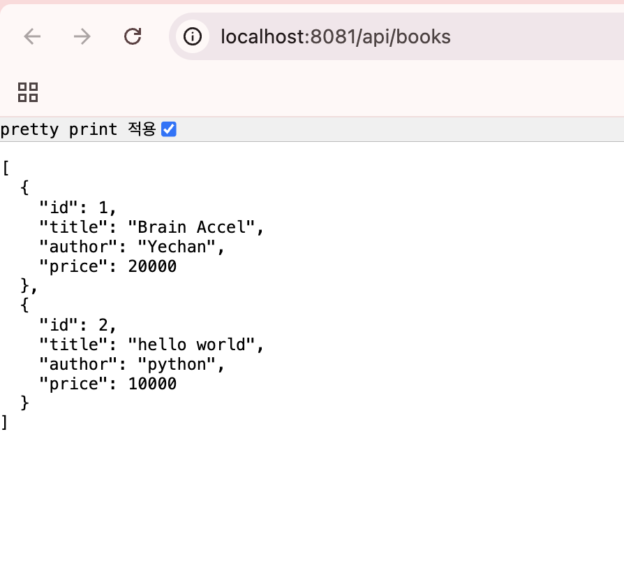
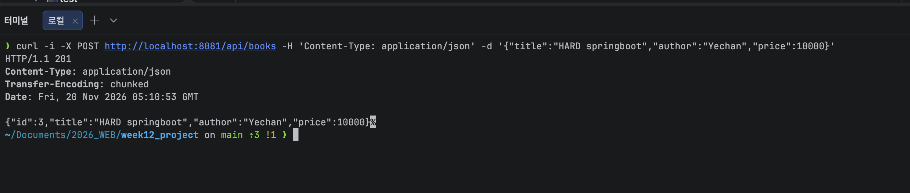
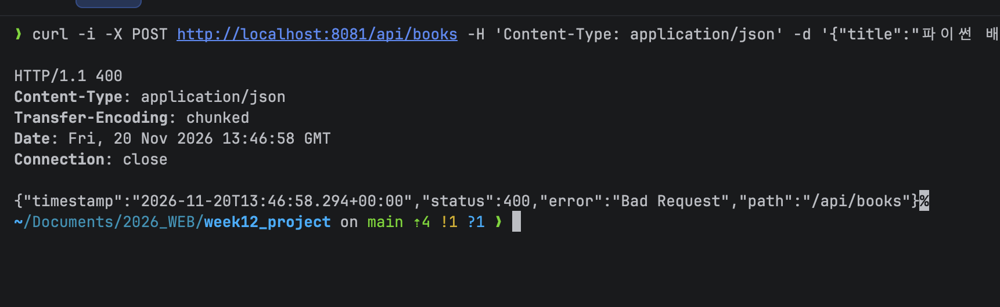
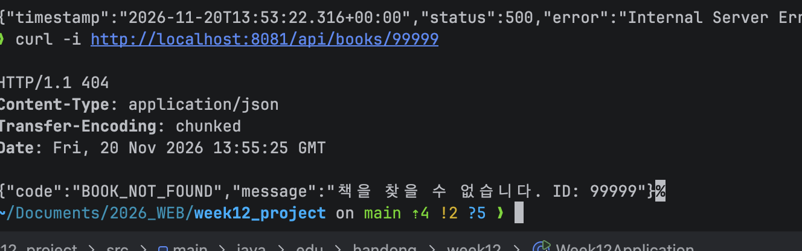
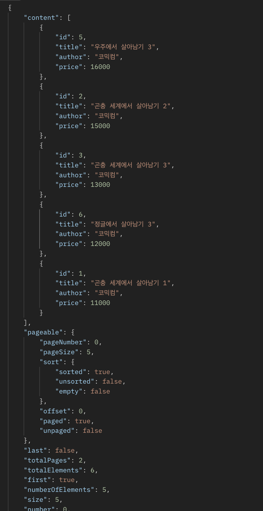
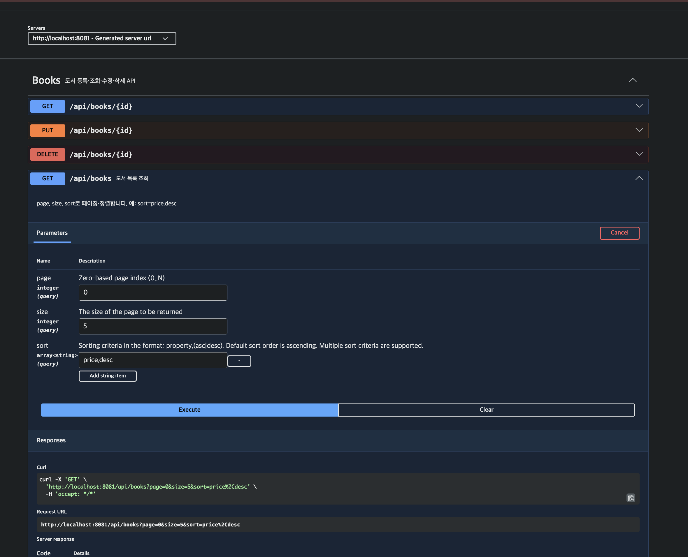

# 1 Project Information: 프로젝트 소개, GitHub URL, Render URL

## 프로젝트 소개

Spring Boot Sample Project를 바탕으로 만든 도서 관리 REST API이다. 책의 제목, 저자, 가격을 등록하고 조회·수정·삭제할 수 있다. 기본 CRUD에 DTO, 입력 검증, 공통 예외 처리, 페이징·정렬과 Swagger를 추가했다. 

## GitHub URL

- 개인 : https://github.com/yechan-7942/week12_project
- origin : https://github.com/2026-2-WebService/assign12-c01-22500802

## Render URL

- 도서 목록: https://week12-webservice-project.onrender.com/api/books
- Swagger UI: https://week12-webservice-project.onrender.com/swagger-ui/index.html

# 2 Installation

Java 17과 프로젝트에 포함된 Gradle Wrapper를 사용한다.

환경 변수 설정: DB_URL, DB_USERNAME, DB_PASSWORD

# 3 Source Code Exploration

## 1. BookController, BookService, BookRepository의 역할과 요청 처리 흐름은 무엇인가?

BookController는 요청을 받고, BookService는 요청에 맞게 책을 등록하거나 조회하는 처리를 한다. BookRepository는 DB에 책을 저장하거나 가져오는 역할을 한다. 책을 등록하면 BookController.create() → BookService.create() → BookRepository.save() 순서로 처리되고, 저장된 책은 BookResponse.from()으로 응답 DTO로 바꿔 반환한다.

관련 파일: BookController.java, BookService.java, BookRepository.java, BookResponse.java

## 2. JpaRepository를 상속하는 것만으로 findAll(), save()를 사용할 수 있는 이유는 무엇인가?

JpaRepository에는 조회나 저장 같은 기본 기능이 이미 준비되어 있다. BookRepository가 이를 상속하고 Spring Data JPA가 실제 동작을 구현해 주기 때문에 findAll()이나 save()를 직접 작성하지 않아도 사용할 수 있다. Book은 저장할 객체이고, Long은 책 ID의 자료형을 뜻한다.

관련 파일 및 메서드: BookRepository.java의 JpaRepository 상속, findAll(), save()

## 3. Book Entity를 직접 요청·응답에 사용하면 어떤 문제가 생길 수 있는가?

Book Entity를 그대로 사용하면 서버에서 관리하는 ID도 요청으로 받을 수 있다. 또한 Book에 필드를 추가하면 응답에도 영향을 줄 수 있다. DTO를 사용하면 입력받을 값과 응답으로 보여 줄 값을 따로 정할 수 있다.

관련 파일 및 메서드: Book.java, BookRequest.java, BookResponse.java의 from(), BookController.java의 create()

## 4. Request DTO와 Response DTO를 분리하는 이유와 ResponseEntity가 필요한 상황은 무엇인가?

요청할 때는 제목·저자·가격만 필요하지만, 응답할 때는 생성된 ID도 필요해서 DTO를 나눈다. ResponseEntity는 응답 데이터와 상태 코드를 직접 정할 때 사용한다. create()에서는 등록 성공을 뜻하는 201을, delete()에서는 삭제 성공을 뜻하는 204를 반환하도록 했다.

관련 파일 및 메서드: BookRequest.java, BookResponse.java, BookController.java의 create(), delete()

## 5. @Valid, @NotBlank, @Min은 어느 시점에 어떤 동작을 하는가?

@Valid는 요청 데이터가 DTO에 담긴 뒤 Controller 메서드가 실행되기 전에 입력값을 검사하게 한다. @NotBlank는 제목과 저자가 null이거나 비어 있거나 공백만 있는지 검사하고, @Min(0)은 가격이 0 이상인지 검사한다. 조건에 맞지 않으면 저장이나 수정을 진행하지 않고 400을 반환한다.

관련 파일 및 메서드: BookRequest.java, BookController.java의 create(), update(), ErrorHandler.handleValidation()

## 6. @RestControllerAdvice와 @ExceptionHandler를 사용하면 예외 처리 흐름은 어떻게 바뀌는가?

오류가 발생했을 때 각 API에서 따로 처리하지 않고 공통 처리기에서 처리하게 된다. @RestControllerAdvice는 공통 예외 처리를 등록하고, @ExceptionHandler는 발생한 예외에 맞는 메서드를 실행한다. 여기서는 ErrorHandler에서 오류를 받아 code와 message가 있는 JSON으로 반환한다.

관련 파일 및 메서드: BookController.java의 ErrorHandler.handleValidation(), handleInvalidJson(), handleNotFound()

## 7. Pageable과 Page는 어떤 역할을 하며 sort=price,desc는 어떻게 처리되는가?

Pageable은 몇 번째 페이지인지, 몇 개를 보여 줄지, 어떤 순서로 정렬할지를 담는다. Page는 조회한 책 목록과 전체 개수, 전체 페이지 수를 함께 담는다. sort=price,desc를 보내면 가격이 높은 순서로 조회하고, list()에서 각 책을 응답 DTO로 바꿔 반환한다.

관련 파일 및 메서드: BookController.java의 list(), BookService.java의 findAll(Pageable), BookRepository.java의 findAll(Pageable)

## 8. /v3/api-docs와 /swagger-ui.html의 역할은 무엇인가?

/v3/api-docs는 API의 요청과 응답 정보를 JSON으로 보여 준다. /swagger-ui.html은 이 정보를 화면으로 보여 주고, 직접 요청을 보내 테스트할 수 있게 한다. @Tag로 도서 API를 묶고, @Operation으로 목록 조회와 등록 API에 설명을 추가했다.

관련 파일 및 메서드: build.gradle, BookController.java의 @Tag, list()와 create()의 @Operation

## 핵심 코드에 설명 주석을 추가한 메서드

- BookController.create(): 요청 DTO 수신, 입력 검사, 저장 요청, 응답 DTO 변환과 201 반환
- BookService.findById(): Repository 조회, Optional 처리, 결과가 없으면 404 예외 발생
- BookController.list(): 페이지·정렬 조건 전달, 책 목록 조회, 응답 DTO 변환

# 4 Refactoring: DTO와 ResponseEntity 변경 전 후 비교 

## 1. 요청과 응답을 DTO로 변경

수정 파일: BookRequest.java, BookResponse.java, BookController.java, BookService.java

변경 전에는 Controller가 Book Entity를 직접 받고 반환했다. 변경 후에는 BookRequest로 제목·저자·가격을 받고, BookResponse로 ID·제목·저자·가격을 반환하도록 바꿨다. 요청 DTO에는 ID 필드를 두지 않았다.

등록 요청 예시: title은 파이썬 배우기, author는 황예찬, price는 10000이다. 변경 전에는 Book에 이 값을 담았고, 변경 후에는 BookRequest에 담는다. 응답은 두 경우 모두 ID와 책 정보를 보여 주지만, 변경 후에는 BookResponse에 있는 필드만 전달한다. ID는 서버가 생성한다.

## 2. HTTP 응답 상태 코드 변경

수정 파일: BookController.java의 create(), delete()

변경 전에는 POST와 DELETE의 성공 상태 코드를 따로 지정하지 않았다. 변경 후에는 ResponseEntity를 사용해 POST 성공 시 201, DELETE 성공 시 본문 없는 204를 반환하도록 했다. GET과 PUT은 성공 시 200을 반환한다.

## 3. 목록 응답 변경

수정 파일: BookController.java의 list(), BookService.java의 findAll()

변경 전에는 책 목록을 배열로 반환했다. 변경 후에는 content에 책 목록을 담고 totalElements, totalPages, size, number 같은 페이지 정보도 함께 반환한다.

# 5 New Features: Validation, 공통 예외 처리, Pagination/Sorting, Swagger

## 1. Validation

수정 파일: build.gradle, BookRequest.java, BookController.java

제목과 저자에 @NotBlank를 적용하고, 가격에는 @Min(0)을 적용했다. POST와 PUT에서 @Valid로 입력값을 검사한다. 제목·저자가 비어 있거나 가격이 음수이면 400을 반환하며, 가격 0은 허용한다.

## 2. 공통 예외 처리

수정 파일: BookController.java, BookService.java

BookController 안에 ErrorHandler와 ErrorResponse를 두어 공통 오류 응답을 만들었다. 오류 응답에는 code와 message가 들어간다.

- 검증 실패: 400, VALIDATION_ERROR
- JSON 문법이나 필드 타입 오류: 400, INVALID_JSON
- 없는 ID로 조회·수정·삭제: 404, BOOK_NOT_FOUND

BookService.findById()에서 책을 찾지 못하면 404 예외를 발생시킨다. update()와 delete()도 findById()를 사용하므로 같은 방식으로 처리된다.

## 3. Pagination / Sorting

수정 파일: BookController.java, BookService.java

테스트 요청: GET /api/books?page=0&size=5&sort=price,desc

0번 페이지에서 5권을 가격이 높은 순서로 조회한다. 

## 4. Swagger

수정 파일: build.gradle, BookController.java

springdoc 의존성을 추가해 Swagger UI와 OpenAPI JSON을 활성화했다. @Tag로 Books 그룹을 만들고, list()와 create()에 @Operation 설명을 추가했다. 등록 API에는 @ApiResponse로 201 응답도 명시했다.

# 6 Testing & Deployment

### 01. 초기 책 목록 조회

기존에 촬영한 책 목록 조회 화면이다.

### 02. DTO 적용 후 POST 성공 (201)

요청에 ID를 넣지 않고 등록했으며, 생성된 ID와 201 응답을 확인했다.

### 03. 잘못된 입력 요청 (400)

400 응답을 촬영한 화면이다.

### 04. 존재하지 않는 ID (404)

없는 ID 조회 시 404와 BOOK_NOT_FOUND 응답을 확인했다.

### 05. 페이징·정렬

가격 내림차순으로 조회한 5권과 전체 개수·페이지 수를 확인한 화면이다.

### 06. Swagger UI

API 설명과 page·size·sort 입력, 실행 요청 URL을 확인한 화면이다. 200 응답과 응답 본문까지 보이는 사진을 추가하면 실행 결과를 볼수 잇다. 

## Render 배포

Render 배포 주소: https://week12-webservice-project.onrender.com/api/books

Swagger 주소: https://week12-webservice-project.onrender.com/swagger-ui/index.html

# 7 Weekly Review

## 새롭게 배운 내용 3가지

1. Entity와 DTO의 차이를 알게 되었다. DB에서 사용하는 객체와 요청·응답에 사용하는 객체를 나누면 필요한 필드만 주고받을 수 있다.
2. Swagger를 처음 사용해 봤다. API 설명을 확인하고 화면에서 직접 요청을 보내 결과를 볼 수 있다는 것을 알게 되었다.
3. 같은 오류라도 상태 코드가 다르다는 것을 배웠다. 잘못된 입력은 400, 없는 책을 조회하면 404를 반환하도록 구분했다.

## 어려웠던 점과 해결 방법

Swagger를 처음 사용해서 어떻게 설정하고 테스트해야 하는지 어려웠다. 
AI의 도움을 받았다., 직접 책 목록 조회 요청을 보내면서 사용 방법을 익혔다. 

## AI 활용 내용 및 느낀 점

AI 활용: Swagger 설정과 사용 방법에서 도움을 받았다. DTO와 예외 처리 구현에도 활용했다.

느낀 점: AI 설명을 읽는 것보다 직접 요청을 보내고 결과를 확인하는 것이 더 이해하기 쉬웠다. 처음에는 Swagger가 낯설었지만 직접 사용해 보니 API를 테스트할 때 편리하다고 느꼈다.
